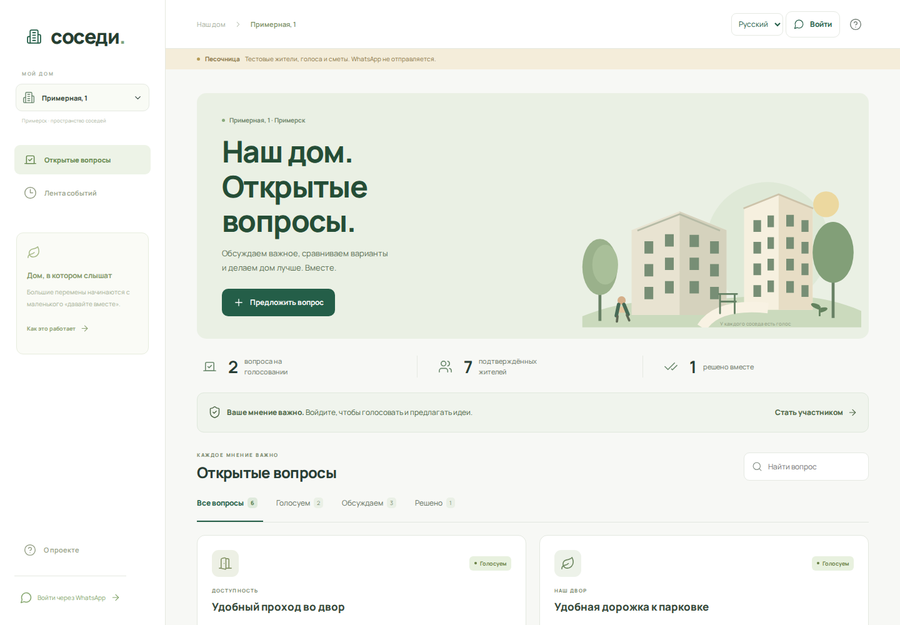
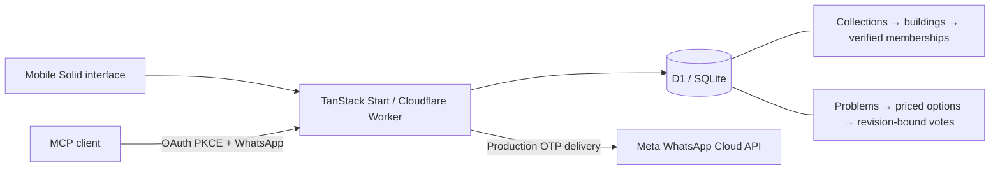

# Соседи

A mobile-first resident decision platform for buildings and building collections. TanStack Start + Solid, `aube`, Cloudflare Workers and D1/SQLite.

The local application is fully connected to local D1. WhatsApp delivery is a sandbox until you configure Meta. No real messages are sent by the sandbox. All bundled buildings, residents, discussions, prices and votes are fictional examples. No private chat exports or production data are included.



## Run locally

Use Node 22.12+ and `aube`. Run from this directory:

```sh
aube install
aube run setup:local
aube run cf:types
aube run db:setup
aube run dev
```

Open `https://localhost:5173`. Local HTTPS uses a development certificate. The setup script creates a random OTP secret in the ignored `.dev.vars` file and preserves an existing configuration.

`db:setup` initializes a fresh sandbox with fictional buildings on Примерная, 1 and Демонстрационная, 1–4 in Примерск. Seed prices, identities, votes and apartment counts are fictional. Run seeding once on a fresh local database; it does not reset existing decisions. Production migrations contain schema only.

| Sandbox role | WhatsApp number | Access |
| --- | --- | --- |
| Resident | `+12025550102` | Verified at Example House 1 and Demo Block 1 |
| Admin | `+12025550103` | Building admin at Example House 1; collection admin for Demo Block 1–4 |
| Webmaster | `+12025550101` | Global webmaster, with no building membership |
| Pending resident | `+12025550109` | Waiting for verification at Example House 1 |

Use **Войти** and select a sandbox account. Request a code, then use the displayed local code. It expires after five minutes. The normal resend limit is one request per minute.

The sandbox requires both `AUTH_MODE=development` and a localhost request hostname. It cannot return development codes on a deployed hostname. Use the localhost URL for sandbox login; a LAN hostname intentionally does not enable mock authentication.

## Resident and admin flows

Residents authenticate through WhatsApp, then request residency or use a number already approved by an administrator. Approved residents see their building's open decisions, options, total price and indicative per-apartment split; they can vote, change a vote until the deadline, comment, and propose problems.

Building admins manage only their assigned building. Collection admins manage every building in their collection. They add solving options, edit prices, open voting with a deadline, record outcomes, approve or revoke residency and assign apartments/entrances. Collection administration is separate from residency: an admin who also wants to vote must have a verified membership in that specific building. Assigning a building admin creates a verified membership; assigning a collection admin does not silently make them a resident of every building.

Admin and webmaster bulk import immediately approves the supplied WhatsApp numbers, including numbers without known apartments. The admin interface previews the approval before writing. Supported input is a number per line or a CSV/TXT file with columns:

```csv
phone;apartment;entrance;name
+12025550100;;;
+12025550110;101;4;Ирина
```

Separators can be semicolons, commas or tabs. Quoted fields and doubled quotes are supported within a line. Names must not contain line breaks. Russian headers `телефон` and `номер` are also accepted. Up to 300 rows are processed in a single atomic D1 batch. Numbers are normalized to E.164 and deduplicated. Blank apartment/entrance fields preserve previously assigned data. Imported numbers retain their existing account identity and roles; imports do not grant admin rights or send WhatsApp messages.

The voting rule is **one verified resident, one vote per problem**. Votes belong to a specific revision. Editing a solving option or its price increments the revision and clears earlier ballots. Concurrent edits using the same revision cannot both succeed. Closing/resolving retains results; reopening or returning to discussion starts a new round. Revoking residency removes that resident's ballots.

The app supports collaborative decisions, not a legally certified owners' assembly or payment collection. Prices are recorded estimates, and per-apartment amounts are indicative.

## Rendering and architecture

The whole web app supports Russian (`ru`) and Volga Tatar in Cyrillic (`tt`). Use **Русский / Татарча** in the header or a dialog to switch immediately. The choice is saved in `localStorage` under `residents.locale`; otherwise, the first supported browser language is used, with Russian as the fallback. Switching keeps the current screen and form input. Interface text, accessibility labels, notices, import validation, system activity messages, dates and prices share the same language preference. Resident-written titles, descriptions, comments, outcomes, names and building data stay as entered.

`src/lib/messages-tt.ts` is the typed catalog: Russian source messages are the IDs and the values are Tatar translations. Use `t()` from `src/lib/i18n.ts` for all app copy, with named placeholders for dynamic values. Keep canonical API and import messages in notice state so existing messages update when the language changes. Date formatting uses `Europe/Moscow` and includes CLDR Tatar month names for browsers without Tatar Intl data. No language prefixes or alternate SEO routes are needed; [TanStack Router supports application-managed translations](https://tanstack.com/router/latest/docs/guide/internationalization-i18n).

`src/start.ts` sets `defaultSsr: 'data-only'`; the index route also explicitly sets `ssr: 'data-only'`. The route loader runs on the server and serializes identity, building permissions and the initial dashboard. Solid renders the interactive app in the browser; the HTML shell remains server-rendered. This follows [TanStack's data-only SSR contract](https://tanstack.com/start/latest/docs/framework/solid/guide/selective-ssr#ssr-data-only).

The custom Worker entry in `src/server.ts` serves the TanStack app, `/api/*`, OAuth discovery and authorization, and `/mcp`. Both web mutations and MCP tools call the same service and permission checks.



Users and sessions are global; residency, apartment, entrance and building-admin roles belong to a `(building_id, user_id)` membership. Collection admins are stored separately. Global webmaster permission does not imply residency and is rechecked on every MCP request. Every problem, option, vote and comment includes a building key; composite foreign keys prevent options and ballots crossing buildings or decisions. Building authorization uses a targeted indexed query.

Authentication uses cryptographically generated codes, HMAC-hashed OTPs, five verification attempts, atomic single-use consumption and rate limits per number/IP. Sessions use a random opaque token; D1 stores only its hash. The cookie is `__Host-residents`, `HttpOnly`, `Secure`, `SameSite=Lax`, `Path=/`, and expires after seven days. Browser mutations require a same-origin request and session CSRF token. There are no auth tokens in localStorage. Private responses use `Cache-Control: private, no-store`. Expired auth records are cleaned by a daily Worker cron.

## Webmaster MCP

Add `https://YOUR_WORKER_HOST/mcp` as a **Streamable HTTP** server in your MCP client. The server advertises OAuth discovery, public-client registration, authorization-code flow with PKCE S256, exact registered redirects and resource binding. Authorization opens the app's WhatsApp login and requires explicit webmaster consent. OAuth tokens last one hour and cannot be used after the user's webmaster role is revoked.

Clients that accept configured Bearer headers can use the **Webmaster · MCP** screen to issue a 24-hour token after WhatsApp login. Tokens are shown once, stored hashed and revocable. This screen also works before the first building has been created.

```json
{
  "mcpServers": {
    "residents": {
      "url": "https://YOUR_WORKER_HOST/mcp",
      "headers": { "Authorization": "Bearer YOUR_ISSUED_TOKEN" }
    }
  }
}
```

Read tools: `list_buildings`, `list_decisions`, `get_decision`, `list_residents`.

Management tools: `create_collection`, `create_building`, `assign_role`, `bulk_approve_residents`, `verify_resident`, `create_problem`, `save_solving_option`, `set_decision_status`, `request_residency`, `vote`, `comment`. The vote tool still requires verified residency.

For example, create a collection, create its buildings, then call:

```json
{
  "buildingId": "RETURNED_BUILDING_ID",
  "residents": [
    { "phone": "+12025550100" },
    { "phone": "+12025550110", "apartment": "101", "entrance": "4" }
  ]
}
```

Pass that input to `bulk_approve_residents`. To assign a collection admin, call `assign_role` with `phone`, `scope: "collection"` and the collection ID as `scopeId`. Phone numbers must first exist through an import or WhatsApp login. To revoke a role, include `revoke: true`.

## Connect your production accounts later

1. Authenticate your Cloudflare account with `aube exec wrangler login` and create the D1 database with `aube exec wrangler d1 create residents`. Copy `wrangler.jsonc` to the ignored `wrangler.local.jsonc` and put the returned database ID, your Worker name, and any deployment-specific settings in that private copy. Keep the committed config generic; its all-zero ID is a local placeholder. The deploy script selects this private config through `RESIDENTS_WRANGLER_CONFIG`; ordinary local builds use the committed template.
2. Configure your approved Meta WhatsApp authentication template. `config/whatsapp-authentication-template.json` supplies the Russian **AUTHENTICATION / COPY_CODE** template with a five-minute footer. Copy-code works across mobile browsers and desktop without native Android app signing requirements. See [Meta's official copy-code template example](https://www.postman.com/meta/whatsapp-business-platform/request/6vkv46u/create-authentication-template-w-otp-copy-code-button). Template approval and actual delivery require your connected Meta account and are not exercised by the sandbox.
3. Set `WHATSAPP_TEMPLATE_NAME`, `WHATSAPP_TEMPLATE_LANGUAGE` and the supported `WHATSAPP_GRAPH_VERSION` in `wrangler.local.jsonc`. Configure secrets through these interactive commands; do not put them in source or either config file:

   ```sh
   aube exec wrangler secret put OTP_SECRET --config wrangler.local.jsonc
   aube exec wrangler secret put WHATSAPP_ACCESS_TOKEN --config wrangler.local.jsonc
   aube exec wrangler secret put WHATSAPP_PHONE_NUMBER_ID --config wrangler.local.jsonc
   aube exec wrangler secret put BOOTSTRAP_WEBMASTER_PHONE --config wrangler.local.jsonc
   ```

   `OTP_SECRET` needs at least 32 random characters. `BOOTSTRAP_WEBMASTER_PHONE` is your exact E.164 phone number; only a successful OTP verification of that number can bootstrap webmaster permission, including if that number was imported earlier. There is no first-user-becomes-admin behavior.

4. Keep production `AUTH_MODE` as `whatsapp`. Run `aube run db:migrate:remote`, then `aube run deploy`. Deployments use the generated TanStack/Cloudflare Worker build. Local `.dev.vars` overrides are for development and are not production secrets.
5. Sign in with the bootstrap webmaster number. Connect MCP, create your actual groups and buildings, approve/import residents, and assign building or collection admins. Remove the bootstrap phone secret after initial provisioning so later role revocations are not undone by that bootstrap setting.

Never run `seeds/demo.sql` remotely. Actual production prices, apartment counts, resident lists and decisions should be created by your administrators. The current project has not been deployed to a real account.

## Checks

```sh
aube run check
aube test
aube run test:ui
```

`aube test` builds the Worker and exercises the actual HTTP/API/MCP/OAuth boundaries in an isolated Miniflare D1 database, including cookies, OTP replay/lockout, cross-building permissions, apartment-free imports, vote uniqueness, concurrent revisions and voting lifecycle. Browser tests serve the built Worker with isolated D1 and exercise the resident and admin flows at 390px, plus desktop navigation at 1440px. Browser tests need Chromium installed through `aube exec playwright install chromium` if your machine does not already have it. Run `aube run build` before browser tests after source changes. Test data never modifies your development database.

Both suites run without production credentials. Connecting Meta delivery and a real Cloudflare account remains your deployment step.

## Privacy and contributions

Never commit resident imports, private conversations, database exports, credentials, deployment identifiers, local certificates or screenshots from a real installation. `.gitignore` excludes local secrets and configuration, generated Worker types, local databases, build output and captured artifacts. Review the staged diff before publishing changes. See [SECURITY.md](SECURITY.md) for access boundaries and private vulnerability reporting.

## License

Copyright (C) 2026 meoyawn and contributors. Licensed under the GNU General Public License, version 3 only (`GPL-3.0-only`). See [LICENSE](LICENSE).
